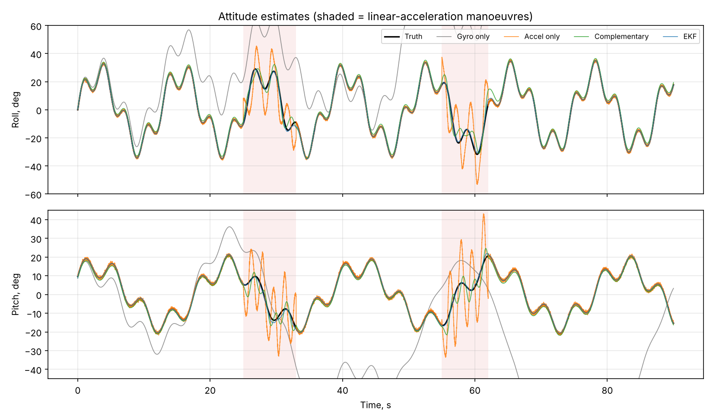
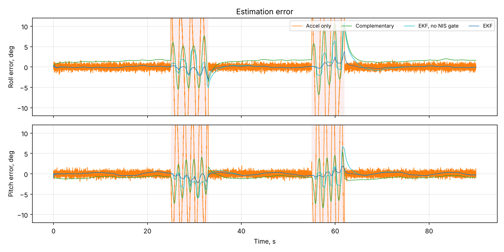
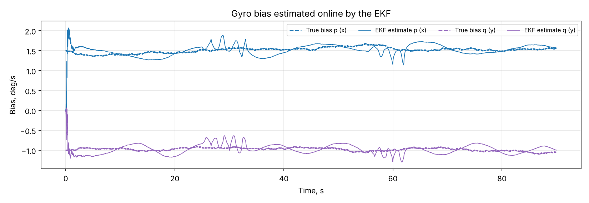

# IMU Sensor Fusion: Complementary Filter vs Extended Kalman Filter

Roll and pitch estimation from a 6-DoF IMU (gyroscope + accelerometer). Four estimators are compared on the same simulated flight with gyro bias, bias drift, sensor noise and linear-acceleration manoeuvres. The EKF estimates gyro bias online and uses adaptive noise plus innovation gating to reject corrupted gravity measurements.



## Results

90 s at 200 Hz. Gyro: 0.3 °/s noise, biases of 1.5 / −1.0 / 0.5 °/s with random walk. Accelerometer: 0.08 m/s² noise plus two manoeuvre windows with 3–4 m/s² linear acceleration (shaded).

| Method | Roll RMSE | Pitch RMSE | Roll RMSE, manoeuvres | Pitch RMSE, manoeuvres |
|---|---:|---:|---:|---:|
| Gyro integration only | 71.6° | 39.5° | 60.2° | 13.4° |
| Accelerometer only | 5.8° | 5.7° | 14.1° | 14.0° |
| Complementary filter (τ = 1 s) | 2.6° | 1.8° | 4.9° | 3.9° |
| EKF, adaptive R only | 1.5° | 1.1° | 2.9° | 2.5° |
| **EKF, adaptive R + innovation gating** | **0.53°** | **0.46°** | **1.1°** | **0.95°** |

What the numbers show:

- **Gyro only** drifts without bound, because bias integrates into angle error (1.5 °/s × 90 s).
- **Accelerometer only** has no drift but cannot tell gravity from acceleration: errors exceed 14° during manoeuvres.
- **Complementary filter** fixes both in the common case, but it never learns the bias, so it keeps a steady ~1.5° offset (bias × time constant). Visible in the error plot below.
- **The EKF** carries gyro bias in its state, so the offset disappears. Adaptive R (inflating noise when |a| ≠ g) handles accelerations that change the magnitude. **Innovation (NIS) gating** catches the ones that only rotate the vector, which cuts the error by another ~3×.



The EKF finds the gyro bias within a second and tracks it within ~0.2 °/s:



## Filter design

State `x = [roll, pitch, b_p, b_q]`.

- **Prediction:** ZYX Euler kinematics driven by bias-corrected gyro rates, with an analytic Jacobian. Biases are modelled as random walk.
- **Update:** roll and pitch from the accelerometer (`atan2` of the gravity vector), with roll innovation wrapped to ±π.
- **Adaptive R:** `R = R0 · (1 + (| |f| − g | / 0.3)²)`.
- **Innovation gating:** if `NIS = yᵀS⁻¹y` exceeds the χ² 99 % bound (9.21, 2 DoF), S is scaled so NIS sits on the bound. The update is softened rather than discarded, so the filter never loses lock.
- **Joseph-form covariance update** with the effective R keeps P symmetric positive-definite. This is checked in the tests.

## Run it

```bash
pip install -r requirements.txt
python run_demo.py    # RMSE table + figures to docs/
pytest -q             # 11 tests
```

## Code layout

```
imu_fusion/
  simulate.py   attitude trajectory, gyro/accel models (noise, bias, random walk, manoeuvres)
  filters.py    accel tilt, gyro integration, complementary filter, AttitudeEKF
run_demo.py     comparison, RMSE table, plots
tests/          model consistency, estimator ranking, bias convergence, covariance health
```

## Possible extensions

- Magnetometer update for yaw (full AHRS), or a quaternion error-state filter (MEKF) to avoid the Euler singularity at ±90° pitch
- Fixed-point C port of the EKF for a Cortex-M MCU
- Validation on a recorded dataset with optical ground truth

## License

MIT
